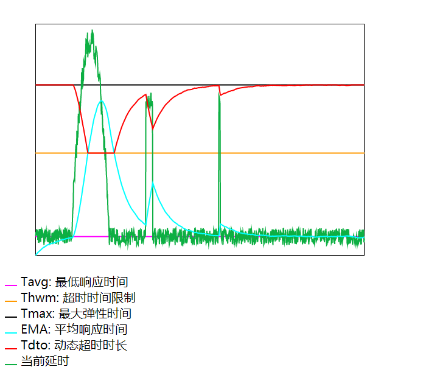

# ema-timeout

[简体中文](./README.zh-CN.md) | English

[![NPM version][npm-image]][npm-url]
[![npm download][download-image]][download-url]

[npm-image]: https://img.shields.io/npm/v/ema-timeout.svg?style=flat-square
[npm-url]: https://npmjs.org/package/ema-timeout
[download-image]: https://img.shields.io/npm/dm/ema-timeout.svg?style=flat-square
[download-url]: https://npmjs.org/package/ema-timeout

Adaptive request timeouts calculated from an **Exponential Moving Average (EMA)** of observed response times.

EMA is usually used in finance to predict the next period from historical data. This library adapts the idea to timeout control by introducing an "average effect": instead of requiring *every* request to finish within a fixed timeout, it uses the **average** response time as the health signal. The design goals are:

- the overall service level must not be exceeded;
- the better the average behaviour, the more headroom ("elasticity") is granted to individual slow requests;
- the worse the average behaviour, the smaller that headroom — failures are detected faster so graceful degradation can kick in.

Here *elasticity* means the maximum response time a spike is allowed to consume.

[Interactive chart](https://fefeding.github.io/ema-timeout/test/index.html)



## Features

- Zero dependencies, single file, pure CommonJS, no timers or I/O.
- Validated configuration, read-only derived state, explicit bounds clamping.
- No cold-start bias: the first sample seeds the EMA directly.
- `reset()`, `configure()` and `toJSON()` for warm starts, live tuning and observability.
- Handwritten TypeScript declarations and an assertion-based test suite.

## Install

```bash
npm i ema-timeout --save
```

```js
const ema = require('ema-timeout');
```

## How it works

`create(options)` holds an EMA value `ema` (initial `0`), a sample counter, and a smoothing factor

\[
r = \frac{2}{N + 1}, \qquad ema \leftarrow x \cdot r + ema \cdot (1 - r)
\]

where `x` is the latest observed latency in milliseconds. **The first sample seeds the EMA directly** (`ema = x`), so the recommended timeout reflects reality from the very first request instead of staying at `Tmax` for ~`N` requests.

`get()` maps that EMA to a timeout:

| Condition | Result | Meaning |
| --- | --- | --- |
| `ema <= Tavg` | `Tmax` | Health is better than the baseline: grant the maximum elasticity. |
| `ema >= Thwm` | `Thwm` | Latency is consistently bad: clamp to the high-water mark and fail fast. |
| otherwise | `Thwm + p * (Tmax - Thwm)`, where `p = (Thwm - ema) / (Thwm - Tavg)` | Linear interpolation between the two bounds. |

The result is explicitly clamped to `[0, Tmax]`. Configuration is validated so `Tmax >= Thwm > Tavg >= 0` and `N >= 1`, which keeps the interpolation interval well-defined.

## API

### `ema.create(options?)`

Creates an independent timeout calculator. `options` is a plain object; `null`/`undefined` values fall back to defaults, and the caller's object is never modified. Invalid values throw `TypeError` / `RangeError`.

| Option | Default | Unit | Description |
| --- | --- | --- | --- |
| `Tavg` | `60` | ms | Baseline response time; in practice the measured average response time. Must be `>= 0`. |
| `Thwm` | `250` | ms | High-water mark / timeout ceiling. Must be `> Tavg`. |
| `Tmax` | `500` | ms | Maximum elastic time granted when the service is healthy. Must be `>= Thwm`. |
| `N` | `80` | samples | Smoothing window. Must be `>= 1`. Smaller values weight recent samples more heavily; larger values react more slowly and take longer to converge. |

Returns a calculator with **read-only getters** and methods:

| Member | Type | Description |
| --- | --- | --- |
| `options` | `Readonly<EmaOptions>` | Frozen, validated configuration. Assigning to any derived field throws `TypeError` at runtime; use `reset()` / `configure()`. |
| `ema` | `number` | Current EMA (ms). |
| `r` | `number` | `2 / (N + 1)`, recomputed when configuration changes. |
| `samples` | `number` | Samples fed since creation / last `reset()`. |
| `update(x)` | `(number) => number` | Feed a latency sample, return the new EMA. |
| `get()` | `() => number` | Recommended timeout in ms, clamped to `[0, Tmax]`. |
| `reset(initialEma?)` | `(number?) => void` | Clear the running average, or warm-start it from a known EMA. |
| `configure(patch)` | `(Partial<EmaOptions>) => Readonly<EmaOptions>` | Validate and apply a partial configuration update. |
| `toJSON()` | `() => EmaSnapshot` | `{ options, ema, samples }` for persistence / logging. |

### `update(x)`

Feed the elapsed time of the most recent request, in milliseconds. `x` must be a finite, non-negative number; `NaN`, strings, `undefined` and negative values throw instead of corrupting the EMA. Call it on **every** request, successful or not. For a timed-out request the sample should reflect at least the timeout you allowed:

```js
emaObj.update(Math.max(Date.now() - start, options.Tmax));
```

### `get()`

Return the currently recommended timeout. Call it just before issuing the request and pass the value as the request timeout.

### Module-level exports

| Export | Description |
| --- | --- |
| `create(options?)` | Calculator factory. |
| `DEFAULTS` | Frozen defaults `{ Tavg: 60, Thwm: 250, Tmax: 500, N: 80 }`. |
| `validateConfig(config)` | Validate a full configuration up front (throws on invalid values). |

## Usage

Create one instance per backend endpoint (or per dependency), because latency profiles differ:

```js
const ema = require('ema-timeout');

const options = {
  Tavg: 55,   // baseline / average response time (ms)
  Thwm: 300,  // timeout ceiling (ms)
  Tmax: 500,  // maximum elastic time (ms)
  N: 90       // smoothing window
};
const emaObj = ema.create(options);
```

```js
const start = Date.now();
const tdto = emaObj.get(); // recommended timeout for this request

try {
  const result = await request({ timeout: tdto }); // your business request
  emaObj.update(Date.now() - start);
} catch (e) {
  // treat a failure as at least Tmax, so the EMA reflects service health
  emaObj.update(Math.max(Date.now() - start, options.Tmax));
}
```

Live tuning and warm starts:

```js
emaObj.configure({ N: 40 });      // react faster from now on
emaObj.reset(120);                // warm-start from a known average
console.log(emaObj.toJSON());     // { options, ema, samples }
```

## TypeScript

`index.d.ts` is shipped and declared through `types` / `exports`; no `@types` package is needed.

```ts
import { create, DEFAULTS, validateConfig, type EmaOptions, type EmaTimeout } from 'ema-timeout';

const options: Partial<EmaOptions> = { Tavg: 55, Thwm: 300, Tmax: 500, N: 90 };
validateConfig({ ...DEFAULTS, ...options });

const calc: EmaTimeout = create(options);
const timeout: number = calc.get();
calc.update(42);
```

`EmaOptions`, `EmaSnapshot`, `EmaTimeout` and `Readonly<EmaOptions>` are exported; derived state is typed as read-only, so accidental writes are a compile error.

## When to use

- Fixed business logic executed in a loop (e.g. FastCGI / S++ style services).
- The process spends most of its time waiting for responses, not doing CPU work or I/O interrupts.
- Serial request handling, where a single slow or anomalous request blocks everything behind it.
- Response-time distribution that does not fluctuate wildly.
- Graceful degradation / lossy service is acceptable.

It is a poor fit for CPU-bound jobs, highly bimodal latency distributions, or situations where every single request must meet a hard deadline — use a fixed timeout in those cases.

### Tuning notes

- `Tavg` should come from steady-state measurements, not from a guess.
- `Thwm` is the hard ceiling: how long you can afford to wait in the worst case.
- `Tmax` is only reached while the EMA is healthy; setting it far above `Thwm` increases the cost of individual spikes.
- `N` controls the trade-off between smoothness and reaction speed. Use `reset(knownAverage)` when you already have historical data.

## Limitations and known issues

- **Breaking change vs 1.0.x:** invalid configurations and invalid samples now **throw** instead of silently producing `NaN`; `Tmax >= Thwm > Tavg >= 0` and `N >= 1` are enforced. Review existing configuration before upgrading.
- **First sample seeding:** the first `update(x)` sets `ema = x` (instead of `x * r`). This removes cold-start bias but makes the very first timeout react immediately to a single outlier. Use `reset(knownAverage)` if that is undesirable.
- **Minimal model:** a plain EMA only — no percentiles, variance, outlier rejection, sample cap or retry/backoff policy. It does not distinguish timeouts from successes; the caller must encode that in the sample value.
- **Runtime format:** CommonJS only (TypeScript declarations are provided, but there is no ESM bundle).
- **Chart page:** `test/index.html` is a visualisation, not a test runner; `npm test` runs the assertion suite in `test/index.js` (15 checks).

## Repository layout

| Path | Purpose |
| --- | --- |
| `index.js` | `create()` and helpers |
| `index.d.ts` | Handwritten TypeScript declarations |
| `test/index.js` | Assertion-based test suite (`npm test`) |
| `test/index.html` | Interactive chart (GitHub Pages) |

## Development

```shell
npm test   # node ./test/index.js — 15 assertion checks, no external dependencies
```

## License

MIT © jiamao
